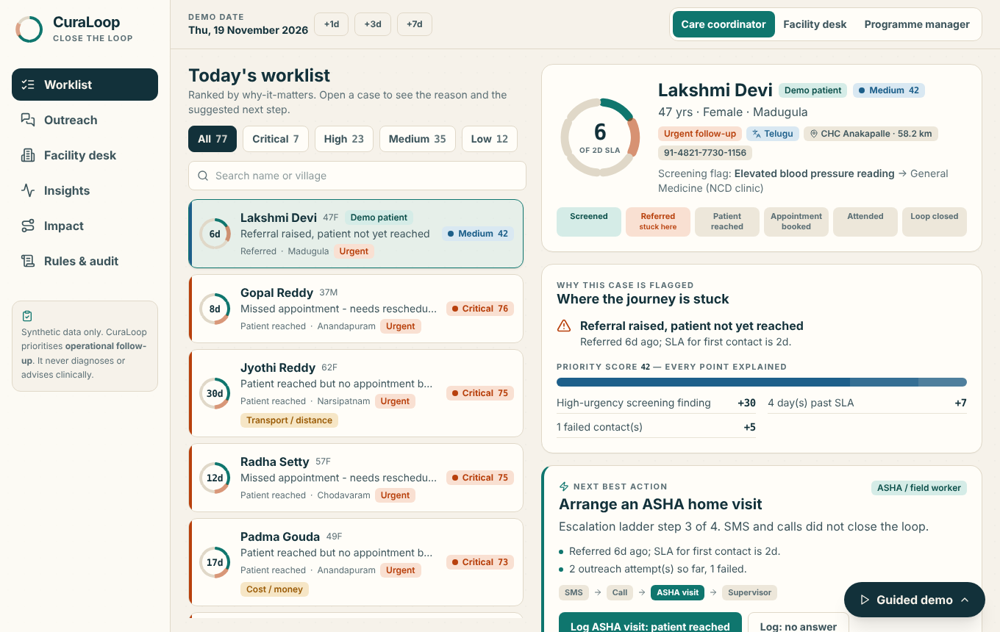

# CuraLoop


**A screened patient is not a treated patient.** CuraLoop tracks every screen-positive person from the camp to a confirmed visit at the facility, and tells the coordinator who to chase today and why.

Built for the Hack2Skill *Future Health Digital Innovation Challenge*, track **[Population Health] Closing the Screening-to-Care Loop**.



> Everything on screen is synthetic data. CuraLoop manages follow-up. It does not diagnose and its messaging agent gives no medical advice.

## The problem
At a screening camp a woman has a suspicious result and gets a referral slip. The register says *referred*. Whether she ever reached the hospital is nobody's job to know, so the case is counted as done. People are lost between the camp and the clinic because the system measures activity, not arrival.

## What CuraLoop does
**One rule:** only the receiving facility can close a loop. A coordinator cannot tick it off, a manager cannot, the system cannot. The server enforces it in two places.

Around that rule:

- **Worklist.** Open cases ranked by a score you can read: urgency, days overdue against the SLA, failed attempts, distance. Every point is shown. SLAs are editable by the programme manager and every edit is logged.
- **Next best action.** The suggestion depends on *why* the patient is stuck. Bus fare problem gets an ASHA visit with travel support; "didn't understand" gets a call in her language; a dead phone number gets a home visit. Escalation runs WhatsApp, call, ASHA, supervisor.
- **Outreach in Telugu, Hindi and English.** Patients reply "1" or free text. The agent picks out the barrier, updates the case, and drafts a reply. Anything that promises something waits for a human to approve. A symptom word (bleeding, chest pain) gets a fixed safety message and alerts a clinician. STOP is honoured immediately.
- **Facility desk.** What each facility is expecting, what has attended, what is waiting for an outcome. Facilities see their own delay.
- **Insights for managers.** Time-to-care curves that treat open cases honestly (censored, not counted as failures), a process map of where patients actually stall compared with the ideal path, closure by distance and gender with the 80% rule, and a facility table.
- **Planner.** With 25 calls and 6 ASHA visits today, who gets what? An integer programme decides. A Monte Carlo what-if shows the 30-day effect of more ASHAs, two-way WhatsApp or transport money.
- **Impact.** Compares working the list against doing nothing and against a plain register, then shows how much of the gain remains if our assumed effects are half or a quarter as strong. Then a district projection you can edit.
- **Governance.** Roles, audit log of every action, consent and opt-out, a de-identified export, FHIR R4-aligned records, a WhatsApp Cloud API webhook with signature checks.

## Run it
Python 3.10+. Node is not needed to run, the built UI is included.

```bash
pip install -r backend/requirements.txt
python run.py                # http://localhost:8000    API docs at /docs
python run.py --reset        # wipe and reseed the demo data
```
With Docker and PostgreSQL: `docker compose up --build`. Public deployment (Render + Vercel) and pilot mode with real login: [docs/DEPLOY.md](docs/DEPLOY.md).

To work on the UI: `cd frontend && npm install && npm run dev` (port 5173, proxies to 8000), then `npm run build`.
Tests: `cd backend && python -m pytest -q` (88 tests, also green on PostgreSQL 16).

## Try it in three minutes
Press **Guided demo** (bottom right). It walks Lakshmi, 47, from a five-day-old urgent referral to a closed loop:

1. She is already flagged: referral 5 days old against a 2-day SLA, one failed call, score explained.
2. She replies in Telugu that the fare is the problem. The agent reads it as a transport barrier.
3. The coordinator approves the reply; the suggested action changes from "call again" to an ASHA visit with travel support.
4. She confirms. Move the clock three days. The facility records her attendance, then confirms the outcome.
5. The loop closes. Switch to Care coordinator and try closing it yourself: the system refuses.

Switch roles top right: Care coordinator, Facility desk, Programme manager. The time machine (+1, +3, +7 days) shows SLA breaches and no-shows as they would unfold.

## What we claim, and what we do not
- The data is synthetic, generated with a distance effect and a gender effect planted in it, so we can check that the analytics find them. That shows the audit works. It says nothing about any real programme.
- The action effects (how much a call or a visit raises the chance of arriving) are expert assumptions. The Impact tab shows results at 25%, 50% and 100% of them. The simulator finds a clear gain over doing nothing, and a gain over a manual register whose range includes zero; the pilot is built to settle that.
- The one outside number we use, 55% of screen-positive adults still in care at six months, comes from a Bhopal study ([Pakhare et al., BMJ Open 2021](https://bmjopen.bmj.com/content/bmjopen/11/8/e045997.full.pdf)). One city, one condition.
- Messaging runs on a built-in simulator; the webhook is ready for the WhatsApp Cloud API but no live number is connected. Telugu and Hindi templates need review by native speakers.
- FHIR output is structurally aligned, not validated against ABDM profiles. No SSO, offline mode or external security audit yet.

## Pilot, business model, governance
[Pilot plan](docs/PILOT_PLAN.md) · [Business model](docs/BUSINESS_MODEL.md) · [Data governance](docs/DATA_GOVERNANCE.md) · [Responsible AI](docs/RESPONSIBLE_AI.md) · [Technical documentation](docs/TECHNICAL_DOCUMENTATION.md) · [Architecture](docs/ARCHITECTURE.md)

## Repository
```
run.py               one-command launcher
backend/app/         API, services, analytics, synthetic data
backend/app/engine/  state machine, gaps, next-best-action, outreach, optimizer, survival, process mining, simulator, FHIR
backend/tests/       88 tests
frontend/src/        React, TypeScript, Tailwind, hand-drawn SVG charts
docs/                submission documents, architecture, screenshots
```
