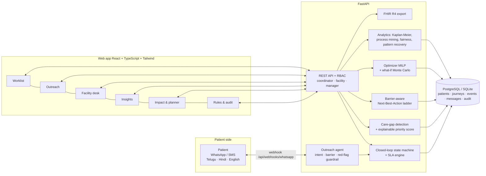

# CuraLoop architecture



## The closed-loop rule
```
SCREENED -> REFERRED -> CONTACTED -> SCHEDULED -> ATTENDED -> CLOSED
                           ^            |
                           +-- no-show -+      (any open state -> LOST, manager only, reason required)
```
`CLOSED` is reachable only through `POST /journeys/{id}/outcome` as the **facility** role. The check is enforced twice:
at the endpoint (RBAC, 403) and inside the state machine (409). A coordinator cannot close a loop by ticking a box.

## Data model (FHIR-aligned)
Patient -> `Patient` · Journey -> `ServiceRequest` · Appointment -> `Appointment` · Event -> provenance log ·
Message -> `Communication` · next action -> `Task`. Export: `GET /api/fhir/journey/{id}`.
`events` is append-only and is the input to process mining.
